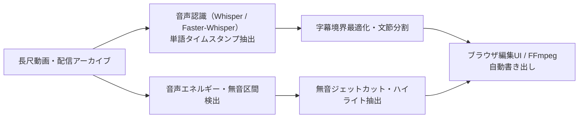

# clip_automation

動画の文字起こし、音声信号エネルギー解析に基づく無音ジェットカット、字幕レイアウト生成、動画書き出し、ハイライト抽出までをローカル環境で自動処理する Python パイプライン＆Web編集UIです。

## 処理パイプライン



## 技術的な特徴

- **発話保護付き・信号ベース無音カット**: `silence_detection.py` が FFmpeg の音声信号解析で無音区間を判定し、Whisper の単語タイムスタンプを発話保護区間として併用することで語尾欠けを防ぎます。
- **LLM + ルール併用による自然な字幕改行・分割**: Faster-Whisper で抽出した単語列をローカルLLM（Ollama: `qwen2.5:14b` 等）またはルールベース（`caption.py`）で意味のある文節へ分割し、タイムアウト時は自動的にルール方式へフォールバックします。
- **単語単位タイムライン編集（v2）と堅牢な永続化**: FastAPI + React/TypeScript のタイムラインエディタ（`editor_api.py` + `editor_frontend/`）では `base_revision` による競合検査、履歴ファイル（`caption_history.jsonl`）の原子的置換、100ステップの Undo / Redo に対応し、未レンダーのソース動画上でプレビューできます。
- **外部エディタ連携ワーカー**: [video_editor (Cutline)](https://github.com/sp9r/video_editor) からサブプロセスとして呼び出せるバージョン付きJSONワーカー契約（[worker contract](docs/contracts/auto_caption_worker_v1.md)）と、`edit_project.v1` 中間フォーマット出力を備えています。
- **中断耐性と検証**: 処理中断時は段階ごとに成果物（`job_manifest.json`, `edl.json`, `transcript.json`）を保全して途中段階から再開でき、書き出し後は EDL 期待尺・コーデック・解像度・FPS を自動検証します。

## 動作要件とセットアップ

- Windows 11 / Python 3.11 / FFmpeg・FFprobe（PATH設定済み）
- NVIDIA GPU（CUDA対応時：Whisper GPU推論・NVENC書き出しを優先、未対応時はCPUへ切替）
- Ollama（任意・字幕文節分割やハイライト抽出に使用：`qwen2.5:14b`, `gemma3`）

```powershell
git clone https://github.com/sp9r/clip_automation.git
cd clip_automation
py -3.11 -m venv .venv
.\.venv\Scripts\python.exe -m pip install --upgrade pip
.\.venv\Scripts\python.exe -m pip install -r .\requirements.txt
```

Ollama モデルを準備する場合:

```powershell
ollama pull qwen2.5:14b
ollama pull gemma3
```

## 起動方法

### Gradio パイプラインUI

`start_gui.bat` を実行するか、PowerShell から起動してブラウザで `http://127.0.0.1:7860` を開きます。

```powershell
.\.venv\Scripts\python.exe .\ui\app.py
```

### タイムラインエディタ UI（FastAPI + React/TypeScript）

```powershell
cd .\editor_frontend
npm install
cd ..
.\start_editor.bat
```

## 主な処理段階と出力物

1. **動画取得・音声抽出**（ローカルファイル／URL入力）
2. **Whisper 文字起こし**（単語タイムスタンプ `transcript_words.json` 生成）
3. **無音解析・EDL生成**（`edl.json`）
4. **字幕生成**（`captions.srt`, `captions.ass`, `caption_project.v2.json`）
5. **動画レンダリング**（`final_jumpcut_video.mp4`、完了前に未検証ファイルを分離）
6. **ハイライト抽出**（`highlight.json`）

各ジョブの出力は `data/runs/YYYYMMDD_HHMMSS/` 配下へ分離して保存されます。

## 設計ドキュメント・契約仕様

- [アーキテクチャ設計 (V2)](docs/ARCHITECTURE_V2.md)
- [字幕品質改善設計](docs/CAPTION_QUALITY_PLAN.md)
- [自動字幕ワーカー契約](docs/contracts/auto_caption_worker_v1.md)
- [編集プロジェクト契約 (`edit_project.v1`)](docs/contracts/edit_project_v1.md)

## ライセンス

MIT License（[LICENSE](./LICENSE)）
