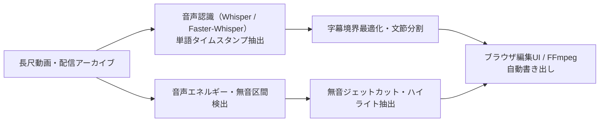

# YouTube Clip Automation 取扱説明書

YouTube動画またはローカル動画を、文字起こし、音声信号ベースの無音カット、字幕生成、動画書き出し、ハイライト提案まで処理するWindows向けローカルアプリです。旧legacy経路にはフィラー除去実装が残りますが、現行のStage 7 silence cutではフィラーを削除しません。


## 処理パイプライン



字幕編集後は同じrunの字幕プロジェクトを保持したままrender以降だけを再実行します。完成動画はEDL期待尺・codec・解像度・FPSを検証し、ハイライト抽出に失敗した場合はジョブをcompletedにしません。旧manifestは読込時にschema v2へ互換移行されます。

利用者はこのファイルを読んでください。開発状況や次の実装作業は [HANDOFF.md](HANDOFF.md) に分離しています。

Phase 5の外部`video_editor` headless render連携の仕様・CLI・manifest・再実行方針は、[docs/PHASE5_HEADLESS_RENDER.md](docs/PHASE5_HEADLESS_RENDER.md)を参照してください。

新規production jobのPhase 6経路（planning → `edit_project.v1` → 外部`video_editor`）は、[docs/PHASE6_PRODUCTION_PIPELINE.md](docs/PHASE6_PRODUCTION_PIPELINE.md)を参照してください。既存runはlegacy互換経路として保持されます。

Phase 7の投稿基盤（renderと分離したpublish manifest、明示的YouTube prepare/publish、OAuth、dry-run、thumbnail、processing status）は、[docs/PHASE7_PUBLISHING.md](docs/PHASE7_PUBLISHING.md)を参照してください。render完了だけでは投稿されません。YouTubeの既定privacyはprivateです。TikTok / Instagram direct publishingは未実装です。

## Spectra Auto Caption Worker boundary

video_editorの「動画選択 → 自動字幕」は、`spectra_caption_worker.py`をlocal processとして起動するversioned JSON boundaryを使います。workerはselected source rangeのtranscribeとcaption segmentationだけを担当し、既存`caption.py`を再利用します。jumpcut、planning、highlight、render、publishは呼びません。

workerはself-contained portable applicationではありません。利用側でPython環境、faster-whisper、Whisper model、FFmpegを用意し、video_editor側のworker discoveryから解決できる必要があります。詳細は[worker contract](docs/contracts/auto_caption_worker_v1.md)と[HANDOFF](HANDOFF.md)を参照してください。

### 2026-08-16 Night 24 final smoke

実人間日本語QA corpus A（188.600秒）で、video_editorから選択clipの全source rangeを処理した。実測代表値は`large-v3 / cuda / float16`、raw words 666件、captions 85件、signal silence 3件、削除候補3.85秒。字幕区切りは高品質LLMがtimeoutしたため、既存`caption.py`のrule fallbackへ安全に切り替わった。これはWhisper skipやstale resultではない。

productionの無音判定は`silence_detection.py`のFFmpeg音声信号authorityであり、Whisper word intervalはspeech protectionだけに使う。filler removalは行わない。CUDAが使えない場合の`auto`は理由付きCPU fallback、`gpu`は明示error、`cpu`は明示CPUで、runtime diagnosticsにdevice／compute type／fallback reasonを残す。workerはportable配布物ではなく、Python環境、model、FFmpeg、consumer側discoveryが必要である。

> **Timeline Editorは開発中ですが、既存runとNew Projectの編集導線を提供しています。** 通常利用はFastAPIのproduction配信（8766）を使います。Previewは未レンダーのソース動画へ字幕を重ねて表示し、動画エンコードは最終Export時だけ実行します。複数トラック、実波形、標準Trim/Ripple/Slip/Slide、エフェクトなどは未実装です。

## 1. 一番簡単な起動方法

1. `C:\Storage\30_Software\90_Self_Made\Apps\clip_automation`をエクスプローラーで開く。
2. `start_gui.bat`をダブルクリックする。
3. 黒い画面に起動完了の表示が出たら、ブラウザで <http://127.0.0.1:7860> を開く。
4. アプリ使用中は黒い画面を閉じない。

PowerShellから起動する場合は次のとおりです。

```powershell
cd C:\Storage\30_Software\90_Self_Made\Apps\clip_automation
.\.venv\Scripts\python.exe .\ui\app.py
```

開発中のTimeline Editorを確認する場合は、初回だけfrontend依存を入れてから起動します。

```powershell
cd .\editor_frontend
npm install
cd ..
.\start_editor.bat
```

ブラウザで`http://127.0.0.1:5173`が開きます。通常利用は`start_app.bat`で8766を起動し、左でREADY runを選びます。中央は未レンダーのSOURCE MEDIA、右はInspector、下は字幕タイムラインです。Spaceで再生／停止、Ctrl+ZでUndo、Ctrl+Shift+ZでRedo、字幕clipの左右ハンドルまたはWhisper単位ボタンで境界を動かせます。

## 2. 終了方法

処理中でなければ、起動時の黒い画面で `Ctrl+C` を押すか、画面を閉じます。

処理中の場合は、先にGUIの「安全に停止」を押し、「停止済み」と表示されてから黒い画面を閉じてください。誤って先に閉じても、次回起動時に中断ジョブとして回収され、同じrunから再開できます。

## 3. 初回セットアップ

すでに`.venv`が存在して起動できる場合、この節の操作は不要です。

### 必要なもの

- Windows 11
- Python 3.11
- FFmpegとFFprobe（PATHから実行可能なこと）
- NVIDIA GPUと対応ドライバー
  - 自動字幕は`auto`ならCUDAを優先し、`gpu`はCUDA不可時に失敗、`cpu`は明示CPUで動作します。最終acceptanceではCUDAを実証できる環境を使用します。
  - 動画書き出しはNVENCを優先し、使えない場合はCPUの`libx264`へ切り替わります。
- Ollama
- Ollamaモデル `qwen2.5:14b` と `gemma3`

### Python環境の作成

PowerShellで実行します。

```powershell
cd C:\Storage\30_Software\90_Self_Made\Apps\clip_automation
py -3.11 -m venv .venv
.\.venv\Scripts\python.exe -m pip install --upgrade pip
.\.venv\Scripts\python.exe -m pip install -r .\requirements.txt
```

### Ollamaモデルの準備

```powershell
ollama pull qwen2.5:14b
ollama pull gemma3
ollama list
```

### 外部ツールの確認

```powershell
ffmpeg -version
ffprobe -version
ollama list
```

## 4. 新しい動画を処理する

起動後、最初に上部の設定を確認します。

| 項目 | 既定値 | 内容 |
|---|---:|---|
| 横解像度 | 1920 | 完成動画の横幅 |
| 縦解像度 | 1080 | 完成動画の高さ |
| FPS | 60 | 完成動画のフレームレート |
| 字幕の文字数上限 | 32 | 字幕1ブロックの目安 |
| 字幕区切り方式 | 高品質LLM | Qwenで意味上の区切りを選択。失敗時はルール方式へ切替 |
| デフォルト字幕 | 標準 | 全字幕へ最初に適用するテンプレート |
| 動画エンコーダー | 自動 | NVENCを優先し、利用不能ならCPU |

### YouTube動画

1. 「動画処理」→「YouTubeから取得」を開く。
2. YouTube URLを入力する。
3. 「バックグラウンド処理を開始」を押す。

### ローカル動画

1. 「動画処理」→「ローカル動画」を開く。
2. 動画ファイルを選択する。
3. 「バックグラウンド処理を開始」を押す。

処理は次の6段階です。

1. 動画取得
2. 文字起こし
3. 無音・フィラー解析
4. 字幕生成
5. 動画レンダリング
6. ハイライト抽出

GUIには現在段階、段階内進捗、重み付き全体進捗、経過時間、残り時間の目安が表示されます。

## 5. 停止と再開

### 停止

処理中に「安全に停止」を押します。FFmpegの未完成動画は`*.partial.mp4`として完成動画と区別され、取得済み動画、文字起こし、EDL、字幕などの完了成果物は残ります。

### 再開

1. 「既存run」で対象を選ぶ。
2. 「runを読み込む」を押す。
3. 進捗と状態を確認する。
4. 「未完了段階から再開」を押す。

完成済み段階は検証後にスキップされます。ただし再開粒度は段階単位です。動画レンダリングを途中で止めた場合、レンダリング段階の先頭からやり直します。

## 6. 字幕を編集する

1. 「既存run」で対象を選び、「runを読み込む」を押す。
2. 「③ 字幕確認・修正」タブを開く。
3. 「直近の字幕データを読み込む」を押す。
4. 動画を再生し、字幕本文、開始秒、終了秒、テンプレートを調整する。
5. プレビュー上の編集は、その場で動画上へ反映される。
6. 1件の編集を確定する場合は、プレビュー内の「字幕を保存」を押す。
7. 表形式で編集した場合は、「④ 字幕編集を保存して最終書き出し」を押す。

リアルタイムプレビューは編集用プロキシへ字幕を重ねるため、設定確認のたびに動画を再エンコードしません。完成動画へ反映する時だけ最終書き出しが必要です。

## 7. 字幕テンプレートを作る

「テンプレート管理」タブで次を編集できます。

- テンプレート名
- フォントと文字サイズ
- 文字色と縁取り色
- 太字、斜体、縁取り幅、影
- 9方向の基準位置と上下余白
- X/Y座標による任意配置

保存したテンプレートは、上部のデフォルト字幕テンプレートまたは字幕ごとの個別テンプレートとして選べます。

## 8. フィラー除去

`えー`、`あー`、`あの`、`えっと`、`なんか`、`うーん`、`まあ`など、認識結果が辞書へ完全一致したフィラーは、音声区間と字幕原文の両方から除外されます。

表記揺れ、複合フィラー、Whisperが別の語として認識したものは残る場合があります。

## 9. 出力ファイル

各処理は次の場所へrun単位で保存されます。

```text
data\runs\YYYYMMDD_HHMMSS\
```

主なファイルは次のとおりです。

| ファイル | 内容 |
|---|---|
| `job_manifest.json` | ジョブ状態、進捗、設定、エラー、成果物 |
| `transcript.json` | Whisper文字起こし |
| `edl.json` | 残す音声・映像区間 |
| `clean_transcript.json` | ジャンプカット後の文字起こし |
| `caption_project.json` | 字幕と出力設定の編集プロジェクト |
| `caption_project.v2.json` | Timeline Editor用v2字幕プロジェクト（T1以降で利用。v1は保持） |
| `caption_project.v1.backup.json` | v1→v2移行時に作るv1の保全コピー |
| `transcript_words.json` | Timeline Editor用の不変word正本（T1以降で利用） |
| `captions.srt` | SRT字幕 |
| `captions.ass` | 装飾付きASS字幕 |
| `preview_proxy.mp4` | 既存pipelineが生成した旧来の軽量動画（New Projectでは初期生成しない） |
| 元動画ファイル | New Projectが保持する未レンダーのPreview入力 |
| `final_jumpcut_video.mp4` | 完成動画 |
| `highlight.json` | ハイライト提案 |

`*.partial.mp4`は未完成ファイルです。完成動画として使用しないでください。

## 10. よくある問題

### `http://127.0.0.1:7860`が開かない

- `start_gui.bat`の黒い画面が開いているか確認する。
- エラーで終了していないか確認する。
- すでに別のアプリが7860番ポートを使用していないか確認する。

```powershell
Get-NetTCPConnection -LocalPort 7860 -ErrorAction SilentlyContinue
```

### `ffmpeg`または`ffprobe`が見つからない

FFmpegをインストールし、PowerShellで`ffmpeg -version`と`ffprobe -version`が成功するようPATHを設定します。

### Ollama接続エラーになる

画面上部のhealth barで「未起動」と「必要モデル不足」を区別します。「Ollamaを起動」は明示的に押した時だけ`ollama serve`を試み、「再確認」でAPIとモデル一覧を再取得します。字幕だけを進める場合は字幕区切り方式をルール方式へ変更できます。ハイライト抽出には指定モデルが必要です。

### GPUが使われない

- 動画エンコーダーが「自動（NVENC優先）」または「GPU NVENC」か確認する。
- NVIDIAドライバーを確認する。
- 「自動」はNVENCの小さい実エンコードに失敗するとCPUへ切り替わる。
- WhisperのCUDA利用可否は設定値ではなく、CTranslate2のhealth/model loadとruntime diagnosticsで確認する。`gpu`指定時のCPU fallbackは成功扱いにしない。

### アプリを閉じてしまった

再起動後、「既存run」で対象を読み込みます。前回`running`だったジョブは「中断・再開可能」へ回収され、「未完了段階から再開」で続行できます。

## 11. 現在の制約

- 字幕境界はWhisper word単位で移動できるが、映像・音声クリップの標準Trim/Ripple/Slip/Slideは未実装。
- 音量、BGM、クロップ、回転、速度、トランジション、複数トラック、実音声波形は未実装。
- 自動字幕区切りは常に完全ではないため、最終確認とGUI修正が必要。
- 再開は段階単位で、FFmpegの途中フレームからは再開しない。
- YouTubeへの自動アップロードは未実装。

## 12. 開発者向け資料

- [HANDOFF.md](HANDOFF.md): 実装状況、検証証拠、既知の制約、次の開発作業
- `tests\`: 自動テスト
- Obsidian `30_Projects_and_Ideas\youtube_clip_automation.md`: プロジェクト正本
- Obsidian `30_Projects_and_Ideas\youtube_clip_automation_architecture.md`: 詳細設計

### Timeline Editor v1 の移行原則

既存のGradio字幕編集は引き続き`caption_project.json`（v1）を使います。Timeline Editor用のv2は、v1を上書きせず`caption_project.v2.json`へ別保存します。移行はWhisper word列との厳密な対応付けに成功した場合だけ行い、対応付けできない編集済み字幕はv1を残して手動確認へ回します。UIは字幕JSON全体を保存せず、`base_revision`付きの編集commandを送る契約です。

T1 backendでは`CaptionCommandService`がtext edit、Whisper word単位の境界移動、split／merge、style変更、timing overrideを適用します。各commandはrevision競合とword欠落・重複を検証し、projectをatomic replace、履歴を`caption_history.jsonl`へ保存します。Undo／Redoは100操作を保持し、再起動後も復元します。手動修正済み字幕のsplitも左右表示文を保持したまま実行できます。React／FastAPI／Gradioからの接続はT2以降です。

T2〜T4では、FastAPI APIとReact／TypeScript editorを実装済みです。run一覧、allowlist動画配信、可視範囲timeline、source preview/playhead同期、字幕修正、split／merge、境界移動、Undo／Redo、最終Exportを提供します。Preview APIは30秒範囲を検証するだけでエンコードせず、最終Exportが初回の動画エンコードです。

### Tailscale経由で外部ノートPCから利用する

galleria側のAPIを`127.0.0.1:8766`で起動したまま、Tailscale Serveでtailnet内へ公開します。Funnelは使いません。

```powershell
# galleria上
cd C:\Storage\30_Software\90_Self_Made\Apps\clip_automation
.\.venv\Scripts\python.exe .\editor_api.py
tailscale serve 8766
```

表示された`https://<galleriaのMagicDNS名>.<tailnet>.ts.net`を、Tailscale接続済みのノートPCのブラウザで開きます。停止は`Ctrl+C`、または`tailscale serve reset`です。tailnetのACLとHTTPS有効化が必要です。外部公開が必要な場合だけFunnelを検討し、通常はServeに限定してください。

## 13. プロジェクト全体で見る場所

| 知りたいこと・管理対象 | 正本 |
|---|---|
| アプリの起動・操作・トラブル対応 | この`README.md` |
| 現在の実装、検証証拠、次の開発作業 | アプリ直下`HANDOFF.md` |
| プロジェクト目的とロードマップ | Obsidian `youtube_clip_automation.md` |
| UI最適化の要件・受入条件 | Obsidian `youtube_clip_automation_ui_optimization_spec.md` |
| アーキテクチャ | Obsidian `youtube_clip_automation_architecture.md` |
| 全体TODO | Obsidian `todo_list.md` |
| 開発・テスト・不具合の履歴 | Obsidian `development_log.md` |
| 各runの現在状態・進捗・設定 | `data\runs\<run ID>\job_manifest.json` |
| 字幕プロジェクト | 各runの`caption_project.json` |
| ユーザー字幕テンプレート | `data\user_caption_templates.json` |

日常操作はREADME、開発を始める時は`HANDOFF.md`、計画変更はObsidian正本、実行中の状態はrunごとの`job_manifest.json`を見ます。
