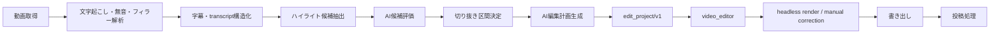
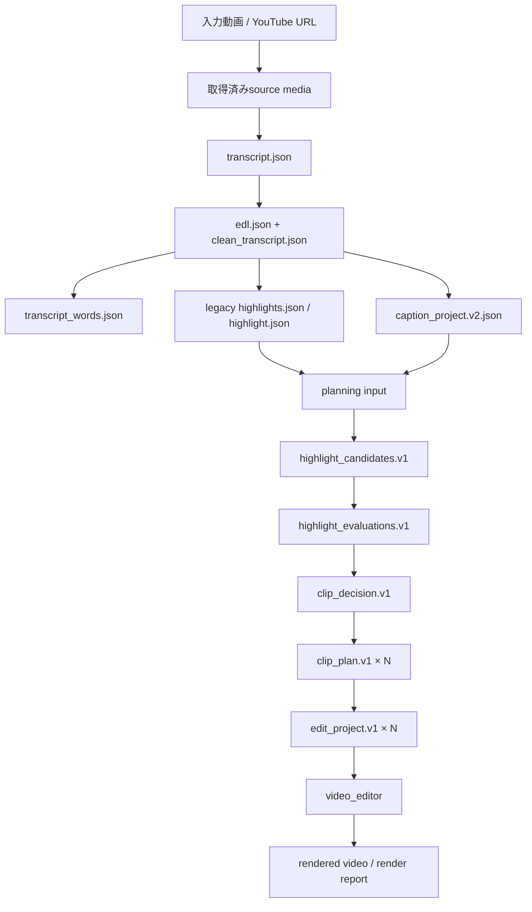

# clip_automation / video_editor 分割アーキテクチャ v2

## Night 24 final acceptance checkpoint (2026-08-16)

実人間日本語QA corpus A（188.600秒）で、`video_editor → spectra.auto-caption.request.v1 → spectra_caption_worker.py`の実運用境界を再確認した。全source rangeを`large-v3 / cuda / float16`で処理し、666 raw words、85 captions、3 signal silences、削除候補3.85秒を得た。Ollama高品質区切りはtimeoutしたため、既存`caption.py`のrule fallbackをdiagnosticsへ記録した。

workerはself-contained portable配布物ではない。Python、faster-whisper、Whisper model、FFmpeg、worker discoveryが必要で、result/baselineへpathやcredentialを保存しない。fine acoustic alignmentは未実装で、raw Whisper wordsがsource truth、文字内のedit unit timingはderived estimateである。今回のA受入はvideo_editor側のtimeline apply、再生、手動本文編集、Save/reopen、CPU/libx264 final renderまでを確認したが、B/Cの完全GUI受入やNVENC GUI PASSを意味しない。

## Stage 9 worker acceptance

自動字幕の実行経路は、`video_editor main → spectra.auto-caption.request.v1 → spectra_caption_worker.py → spectra.auto-caption.result.v1`です。workerはtranscribe＋caption segmentationの専用processであり、既存`caption.py`を再利用します。`caption_project.v2.json`と`transcript_words.json`は引き続きclip_automation側の字幕／transcript資産で、video_editorのProject Modelへ直接共有しません。

resultのraw wordはsource absolute integer microsecondsとstable IDを持ち、captionはsourceWordIds ownershipを持ちます。video_editorは`timelineUs = clip.startUs + (sourceUs - clip.sourceInUs)`で変換します。worker resultとbaselineにpath、credential、media本体は保存しません。

実Whisperは生成QA mediaで`faster-whisper+caption.py` / `large-v3`を受入済みです。ただしworker単体はportable配布物ではなく、consumer側のworker discovery、Python依存、Whisper model、FFmpeg環境が必要です。fine acoustic alignmentは未提供です。

> **Current checkpoint (2026-08-15):** Phase 3.4 and Step 3.5A-1 are CLOSED. The `edit_project.v1` subtitle-words bridge, optional caption `words[]`, zero-duration source-word policy, decimal-seconds validation, subtitle split/merge with Undo/Redo, Save/reload, FFmpeg render, accurate preview, and `word_timing_overrides` parity are accepted. `video_editor` is the future manual subtitle editor authority; the legacy `clip_automation` editor is frozen/reference-only. Step 3.5A-1 added read-only timeline word timing visualization; Step 3.5A-2/3 remain future work.

## 1. 目的と決定事項

最終的な処理は、長尺動画またはYouTube動画を入力として、次の順で自動化する。



責務の境界は次で固定する。

- `clip_automation`: 入力取得、音声・字幕・ハイライト解析、候補評価、切り抜き区間、編集計画、ジョブ管理、最終投稿。
- `video_editor`: 編集Projectモデル、タイムライン、Preview、手動修正、Undo/Redo、メディア・字幕・テキスト編集、FFmpeg等のレンダー、headless render。
- 両者の正式な境界: version付き `edit_project.json`。内部Python/TypeScriptモジュール、DBモデル、UI状態を共有しない。
- 依存方向: `clip_automation → edit_project.json → video_editor`。`video_editor`は`clip_automation`なしで、edit projectまたは動画を開いて利用できる。

今回の変更では大規模な実装・削除・移動を行わず、契約と移行順序を固定する。

## 2. 現在構成から新構成への対応表

| 現在の要素 | 現在の責務 | v2での位置付け | 今回の扱い |
|---|---|---|---|
| `download.py` / `pipeline.py` acquire | YouTube・ローカル動画取得 | `clip_automation` | 維持 |
| `transcribe.py` | Whisper文字起こし・word時刻 | `clip_automation` transcript生成 | 維持 |
| `silence_detection.py` | 音声信号ベースの無音検出、EDL、clean transcript | `clip_automation` 解析・区間候補 | Stage 7 production path。フィラー削除なし |
| `jumpcut.py` | legacyの無音・フィラー除去、EDL、clean transcript | legacy互換 / 既存run | 維持。production silence authorityには使わない |
| `caption.py` / `subtitle_project.py` | 字幕分割、SRT/ASS、字幕project v1 | `clip_automation` 字幕生成 | 維持 |
| `timeline_project.py` / `timeline_preparation.py` | `caption_project.v2.json`と`transcript_words.json` | `clip_automation`内の字幕専用互換資産 | 汎用化しない |
| `highlight.py` / `feedback.py` | 旧LLM候補抽出、候補検証、feedback | legacy互換。新planning pathの入力資産 | 削除・破壊的変更をしない |
| `planning_artifacts.py` / `planning_core.py` | Phase 2 artifact validator、chunk、候補、評価、decision、plan | `clip_automation` planning core | 新規追加 |
| `planning_providers.py` | deterministic/fallback/Ollama provider境界 | `clip_automation` provider adapter | 新規追加。coreから分離 |
| `planning_pipeline.py` / `planning_manifest.py` | Phase 2の独立orchestrationとmanifest | `clip_automation` planning job | 新規追加。旧job/pipelineとは別経路 |
| `edit_regions.json` | keep/delete領域 | `clip_automation`のlegacy/互換中間成果物 | Phase 2正式経路では`clip_plan.v1`内のregionsがper-clip正本。regions未指定のPhase 1互換builderだけが読む |
| `job_manager.py` / `job_control.py` | run、段階進捗、停止・再開 | `clip_automation` orchestration | 維持。editor jobとは分離 |
| `clip.py` | EDL＋字幕をFFmpegで動画化 | 暫定legacy render / 変換検証 | 新editor置換までfallbackとして残す |
| `renderer_html.py` / `preview.py` | 字幕画像・Gradio preview | legacy renderer / 字幕互換 | 今回削除しない |
| `editor_api.py` | editor APIに加えrun作成、media配信、ASS、FFmpeg export | 一時的なlegacy editor gateway | 新video_editorへ段階移管 |
| `project_creation.py` | upload、pipeline起動、creation status | `clip_automation` job入口 | editorから直接importされない形へ移行 |
| `editor_frontend/` | React UI、字幕timeline、inspector、export導線 | legacy editor UI | 旧editorとして保持。新editorは別project |
| `caption_project.v2.json` | 字幕区間・表示文字・style・revision | 字幕専用正本 | 汎用`edit_project`に拡張しない |
| `transcript_words.json` | Whisper wordの不変source/timeline時刻 | transcript専用正本 | 維持 |
| `edit_project.json` | Phase 1でwriter/validatorを追加 | `clip_automation`が発行する正式契約。readerは`video_editor` | 実runへ接続せず、fixture/evaluation copyで検証 |

## 3. 責務境界

### 3.1 clip_automationが所有するもの

- `source_media`の取得元、download metadata、hash、取得失敗情報。
- Whisper等の文字起こし、word時刻、clean transcript、無音・フィラー解析。
- 字幕生成と`caption_project.v2.json`、`transcript_words.json`。
- ハイライト候補、AI評価、feedback、keep/delete区間、切り抜きの採否。
- AIが生成した編集計画。たとえば、使用source、切り抜き範囲、字幕表示、出力preset、投稿metadata。
- jobの作成、キャンセル、再開、リトライ、入力・中間成果物のhash、投稿状態。
- `edit_project/v1`のwriterと、未対応機能を明示するdiagnostic。

`clip_automation`は、Editorがどのボタンを表示するか、Undo履歴をどう保存するか、FFmpeg filter graphをどう組むかを決めない。

### 3.2 video_editorが所有するもの

- `edit_project/v1`を読み込むstandalone project loader。
- sequence、track、clip、caption、transform、volume、enabled/disabledの編集モデル。
- timeline時間とsource時間の変換、Preview、selection、manual correction、Undo/Redo。
- `edit_project.json`と動画ファイルだけで動くUI起動とheadless render。
- FFmpeg等のcodec、filter、audio mix、字幕合成、temporary output、render validation。
- editor固有の保存、autosave、undo history、UI状態。

`video_editor`は`caption_project.v2.json`を正本として書き換えない。必要ならadapterで字幕情報を読み取るが、正式入力は`edit_project/v1`とする。

### 3.3 境界に置かないもの

- Python moduleの直接import。
- `data/runs`の内部ディレクトリ構造への相互依存。
- `job_manager.py`の内部状態をeditor UIが直接読むこと。
- editorのUI状態を`caption_project.v2.json`へ混ぜること。
- editorが候補抽出や投稿APIを呼ぶこと。

## 4. データフローと正本



| 成果物 | 正本 | 所有者 | v2での扱い |
|---|---|---|---|
| 入力動画 | run内の取得済みsourceまたは指定local file | `clip_automation` | `source_media`から参照。editorはpathを所有しない |
| `transcript.json` | Whisperの原文・segment/word | `clip_automation` | 編集禁止の入力資料 |
| `silence_analysis.json` | 音声信号silence、keep range、削除候補、診断 | `clip_automation` | Stage 7 silence analysisの整数µs正本 |
| `edl.json` | silence cut後のsource区間（既存consumer向け秒表現） | `clip_automation` | 互換解析成果物。必要ならedit planへ変換 |
| `clean_transcript.json` | jumpcut後の文字起こし | `clip_automation` | 字幕・候補の入力 |
| `transcript_words.json` | 不変word IDとsource/timeline時刻 | `clip_automation` | 字幕専用正本。直接汎用化しない |
| `caption_project.v2.json` | 字幕の範囲、表示文字、style、revision | `clip_automation` / legacy caption editor | 字幕モデルとして保持 |
| `highlights.json` / `highlight.json` | AI候補と互換単一候補 | `clip_automation` | 候補評価の入力・監査記録 |
| `edit_regions.json` | keep/deleteの決定区間 | `clip_automation` | Phase 1互換経路の中間成果物。Phase 2 per-clipの正本は`clip_plan.v1`内のregions |
| `edit_project.json` | sequenceと編集clipの確定計画 | 境界契約。writerは`clip_automation`、readerは`video_editor` | v1が正式なEditor入力 |
| `highlight_candidates.v1.json` | 全timelineから抽出した候補 | `clip_automation` planning | Phase 2候補抽出の正本 |
| `highlight_evaluations.v1.json` | 候補ごとの再評価・score | `clip_automation` planning | Phase 2評価の正本 |
| `clip_decision.v1.json` | 採用・不採用と理由 | `clip_automation` planning | Phase 2採否決定の正本 |
| `clip_plan.v1.json` | 1候補=1出力のkeep/deleteと出力設定 | `clip_automation` planning | `edit_project.v1`の上位計画 |
| `job_manifest.json` (`planning_manifest.v1`) | stage状態と生成artifactの監査 | `clip_automation` planning job | 単一artifact stageはlegacy fieldsを維持し、`clip_planning`/`contract_generation`は全clipの配列を正本とする |
| render output/report | rendered mediaと検証結果 | `video_editor` | `clip_automation`がjob結果として参照 |
| 投稿metadata/status | 投稿先別状態 | `clip_automation` | editorの責務外 |

既存runでは、既存ファイルを置換せず、同じrunまたは評価copyに変換成果物を追加する。実runへの書き込みが必要になった場合も、hash、atomic write、resume/retry方針をPhaseの受入条件に含める。

### Phase 1で確定した変換境界

Phase 1では、既存の解析成果物を読み取り専用で`edit_project.v1`へ変換する層を追加した。

- `edit_project.py`はeditor API、frontend、FFmpeg、run directoryへ依存しない純粋なmodel/validator/mapping層である。
- `edit_project_adapter.py`は`caption_project.v2.json`、`transcript_words.json`、`edl.json`、regions（Phase 2は`clip_plan.v1`由来、Phase 1互換では`edit_regions.json`）、source media probeからprojectを生成する。入力runへ書き込まない。
- `edit_project_io.py`はvalidator通過後に一時ファイルをfsyncし、atomic replaceでJSONを公開する。JSON出力はsort keyと固定小数桁で決定的にする。
- `tests/fixtures/edit_project_v1/`は評価用copyに使う最小入力であり、`data/runs`の実データではない。

時間は次の3軸を混同しない。

1. source time: 元動画の`edl.json`区間。
2. jumpcut timeline time: EDL区間を詰めた解析上の時間。`edit_regions.json`とword/captionのtimelineが参照する。
3. sequence time: keep区間だけをさらに詰めた最終編集時間。

EDL境界をまたぐkeep区間はsource clipを分割し、同一mapping列からvideo/audioを生成する。captionはword単位でkeep/deleteを判定し、wordの途中を比例推定しない。安全に分割できないmanually corrected字幕は`unsupported` diagnosticで生成を停止する。

生成時の最低限の監査情報は、source run ID、writer/schema version、入力artifactとsource mediaのSHA-256、source media probe、diagnosticsである。

### Phase 2で確定したplanning path

```text
clean_transcript / analysis
  → highlight_candidates.v1
  → highlight_evaluations.v1
  → clip_decision.v1
  → clip_plan.v1 × N
  → edit_project.v1 × N
```

各candidateは原則1本の独立出力へ対応する。複数candidateをglobal `edit_regions.json`へ連結して1本のsequenceにする経路は新しい正本ではない。旧`highlight.py`、旧pipelineのrender後highlight、旧manifestは互換fallbackとして保持し、新経路は`planning_pipeline.run_planning`へ明示的なplanning output directoryを渡して実行する。

`source_media[].path`は`edit_project.json`のparent directoryをresolution baseとする。planning pipelineは各clipのcontract pathをbuilderへ明示し、relative pathを`/`区切りで生成する。per-clip planningでは`plan["regions"]`を直接adapterへ渡し、legacy `run_dir/edit_regions.json`は読み込まない。`regions=None`のPhase 1互換呼び出しだけがlegacy fileを入力にする。

`planning_manifest.v1`のsingle-artifact stageは`artifact_path`/`artifact_sha256`を互換fieldとして残す。`clip_planning`と`contract_generation`は`artifacts[]`へ全clipの`clip_id`、path、SHA-256、schema version、stateを記録し、部分失敗時も成功clipと失敗clipを同じmanifestから追跡できる。

Phase 2では旧pipelineのstage順を変更していない。旧runのresume互換と実run非破壊を優先し、旧job managerへの自動接続はmanifest schema移行とstage受入条件を別途確認してから行う。

## 5. 現状監査で判明した問題

1. 現行pipelineのstage順は`render`が`highlight`より先で、解析→候補→編集計画→編集という最終目標の順序と異なる。
2. 現在、AI編集計画と汎用Editor入力の独立schemaが存在しない。
3. `editor_api.py`はrun作成、media allowlist、字幕command、edit regions、ASS生成、FFmpeg exportを一つの境界で扱っている。
4. `project_creation.py`はeditor APIから直接呼ばれ、editorとpipelineの内部実装が結合している。
5. `editor_frontend`は字幕v2内部モデルを直接利用し、汎用video/audio clipを持つprojectモデルではない。
6. `preview.py`/GradioとReact/FastAPIに別々の字幕編集経路があり、v1/v2の書き込み経路も併存している。
7. `edit_regions.json`は生成・編集されるが、現行editor exportのFFmpeg入力へ適用されない。
8. `job_manager.py`のstage artifact定義は`highlights.json`と`edit_regions.json`を十分に追跡せず、編集計画・投稿処理のstageもない。
9. frontendはbuild確認はあるが、test fileと実ブラウザE2Eの自動化がリポジトリ内で不足している。
10. `format.py`、`thumbnail.py`、`upload.py`は現時点で空のstubであり、投稿とサムネイルは未完了である。

これらは今回のタスクで実装修正しない。Phase計画に移行順と検証条件として残す。

## 6. 移行順序

### Phase 0: 保全と契約準備（完了）

- 現状コード、docs、tests、Git状態を監査する。
- `AGENTS.md`、本書、split plan、`edit_project_v1`を追加する。
- `dev`を壊さず作業branchを作成する。
- 未追跡解析物を削除・追加しない。

完了条件: baselineの標準unittest 77件PASS、frontend build PASS、変更対象を限定したcommit、remote有無を記録。

### Phase 1: edit_project/v1のwriterとfixture（完了）

- `clip_automation`側に、字幕v2・transcript・regions・source metadataから`edit_project/v1`を生成する純粋なadapterを追加する。
- schema validator、JSON fixture、source/timeline time invariant、round-trip testを追加する。
- `video_editor`側の実装はまだ本リポジトリへ移植しない。
- 受入済み: EDL横断分割、keep/delete、source/sequence対応、video/audio一致、caption境界、round-trip、決定性、入力hash不変、NaN/Infinity・欠損参照・重複ID検証。
- 受入済み: Python unittest 91件とfrontend build。adapterのテストは実runではなく一時fixture copyだけを使用する。

完了条件: 実runを変更せず、評価copyとfixtureから同じ入力で決定的なcontractを生成できる。Phase 1の実装と検証は完了した。

### Phase 2: clip_automationの計画生成を独立化（実装完了）

- highlight候補、AI評価、keep/delete、編集計画を別stageと成果物へ分割する。
- `job_manifest`が候補、計画、contractのhashとschema versionを追跡する。
- 既存`caption_project.v2.json`、`transcript_words.json`、legacy `edit_regions.json`は入力として読むだけにする。正式なper-clip regionsは`clip_plan.v1`から渡す。
- `planning/`配下へcandidate/evaluation/decision、`clips/<clip_id>/clip_plan.v1.json`、`edit_project.json`、planning manifestを生成する。
- Phase 1 adapterはper-clip regionsとsequence outputを受け取れるよう拡張し、mappingは再実装しない。
- 受入済み: Phase 2専用17件、全体unittest 108件、frontend build。fixture/evaluation copyのみを使い、実runを変更しない。

完了条件: 編集UI・FFmpegへ依存せず、動画1本から検証済み`edit_project/v1`を生成できる。実装・fixture・manifest・テストは完了した。

### Phase 2.5: contract/planning境界の整合性修正（今回）

- source media pathのresolution baseを`edit_project.json` parent directoryへ固定し、contract pathをbuilder APIへ明示する。portableでない相対pathはdiagnostic/errorにする。
- per-clipの`plan["regions"]`を正式入力とし、legacy `edit_regions.json`をregions指定時のrequired artifactから外す。input hashには実際に使用したartifactだけを記録する。
- planning manifestの複数artifact追跡を追加し、N件のclip plan/projectと部分失敗をclip単位で監査可能にする。
- 旧editor、旧pipeline、実run、video_editor本体は変更せず、Phase 3開始前の受入準備に限定する。

完了条件: CASE A〜K、Phase 1/2 tests、全体unittest、frontend buildがPASSし、各小commitがremoteへpushされている。

### Phase 3: video_editorのstandalone基盤

- 別リポジトリ／別projectとしてsequence・tracks・clipsの最小モデルを実装する。
- `edit_project.json`単体、またはsource動画＋projectでopenできるCLI/GUIを実装する。
- `video_editor`は`clip_automation`をinstall/importせず、contract validatorだけを自前または独立packageとして持つ。

完了条件: `clip_automation`を起動せず、fixtureと実動画でopen、Preview、headless renderができる。

### Phase 4: 手動修正とレンダー

- video/audio/caption/textのtrack、transform、volume、enabled/disabledを実装する。
- Undo/Redo、manual correction、render validation、再現可能な失敗回復を追加する。
- raw source、timeline time、source timeの同期をffprobeとフレーム検査で固定する。

完了条件: 旧editorの主要受入シナリオを、実動画で新editor単独に置換できる。

### Phase 5: 一方向連携とjob orchestration

- `clip_automation`はcontract writerとvideo_editorのCLI/API呼び出しだけを持つ。
- editor内部のHTTP、UI、DB、undo historyへ直接依存しない。
- headless renderのjob結果を`clip_automation`が受け取り、投稿処理へ接続する。
- 失敗時はsource、contract、render reportを残して再実行可能にする。

完了条件: URL入力から候補、計画、contract、render、投稿処理までを一方向jobとして追跡できる。

### Phase 6: 旧editorのfallback化と縮小

- 新editorの実動画受入、長尺、再起動、字幕・音声同期、出力比較を完了する。
- 旧`editor_api.py`/`editor_frontend`は削除せず、legacy/fallbackとして明示する。
- 旧経路の新規書き込みを止めるか、読み取り専用へ段階的にする。
- 旧editorを削除する判断は別の承認済み変更として行う。

完了条件: 旧editorを使わず同等の作業を再現でき、rollbackとして旧経路が残る。

## 7. 変更・テスト・commitの運用

- Phaseごとに、契約、adapter、job、editor、投稿を別commitに分ける。
- 変更前後にPython unittest、必要ならfrontend build、contract fixture test、ffprobe検査を実行する。
- 実runを直接変更する受入は、元runのhashと評価copyを先に固定する。
- commit前に`git diff --cached --name-only`で対象ファイルだけを確認する。
- remoteが存在する場合は正常なcommitをpushする。remoteが存在しない場合は、push不能を報告し、勝手にremote URLを推測・追加しない。

## 8. Phase 5: external headless render integration

Phase 5では、planningで生成済みの各`clips/<clip_id>/edit_project.json`を、外部リポジトリ`video_editor`の公開CLIへ一方向に渡す。clip_automationはeditor内部のTypeScript、UI、HTTP、DB、undo history、FFmpeg graphをimportしない。

```text
planning/clips/clip_000001/edit_project.json
  -> node <video_editor>/scripts/video-editor.mjs render <project> -o <staging.mp4>
  -> clips/clip_000001/automation/rendered.mp4
```

command解決は、明示argv、`VIDEO_EDITOR_COMMAND_JSON`、`VIDEO_EDITOR_ROOT`、兄弟ディレクトリ自動検出の順で行う。実行は常にargv配列と`shell=False`を使い、パスをshell文字列へ変換しない。launcher、Node、`out/cli/video-editor.js`をpreflightで確認し、未build時はbuild方法を含む診断を返す。

出力はclipごとにautomation所有の`rendered.mp4`へ一時ファイルからatomic promoteする。既存の正常出力は失敗した再実行で上書きしない。clip間のconcatは行わず、途中失敗後も後続clipを処理する。`render_manifest.v1.json`は各clipのstate、edit project hash、output hash/size、ログ、stdout、exit code、error、renderer provenanceを記録し、各clip完了後にatomic更新する。

詳細なCLI、path解決、provenance、fake runner、実動画E2Eは`docs/PHASE5_HEADLESS_RENDER.md`に定義する。

## 9. Phase 6 production cutover

新規JobManager jobは`pipeline_version: "v2"`を既定値とし、stage順を次へ固定する。

```text
acquire → transcribe → jumpcut → captions → planning → render
```

`planning`は`clean_transcript.json`、`caption_project.v2.json`、`transcript_words.json`、`edl.json`、source probeを入力に既存`run_planning()`を使う。`render`は既存`render_planning_outputs()`を使い、選択clipごとに外部`video_editor`を呼ぶ。`create_clip()`、`analyze_highlights()`、legacy `final_jumpcut_video.mp4`、concatはv2経路から除外する。

旧`pipeline.py`本体は`run_legacy_pipeline()`として残り、`pipeline_version: "legacy"`またはpipeline_versionを持たない既存manifestだけが利用する。既存runを自動v2化しない。旧editor/frontendもlocal compatibility UIとして残し、新automationのrender authorityにはしない。

JobManagerのrun root manifestとplanning manifestは別物である。

```text
run_dir/job_manifest.json                 # JobManager runtime/status, schema 3
run_dir/planning/job_manifest.json        # planning_manifest.v1
run_dir/planning/render_manifest.v1.json  # external render execution
```

v2のoutput settings変更は`planning`以降、caption settings変更は`captions`以降をinvalidateする。v2のoutput settings authorityはJobManager/current run argumentsであり、caption project checkpointの古いoutput値で上書きしない。`video_encoder`はlegacy-onlyでv2には流さない。render-only retryはplanningとedit_projectを保持し、render manifestのexecution stateだけを再生成する。正常な自動rendered.mp4は事前削除せず、外部runnerのatomic promoteへ委ねるため、失敗・キャンセル時も旧成果物を保持する。planning結果が0 selected clipsの場合は、v2では代表動画を作らないcompleted no-opとして扱う。

Phase 6の実装詳細と受入条件は`docs/PHASE6_PRODUCTION_PIPELINE.md`を正本とする。

## 10. Phase 7 publishing boundary

Phase 7ではrenderとpublishingを分離する。`render_planning_outputs()`、v2 render stage、`video_editor`は外部platform APIを呼ばない。正常なrender完了後も通常JobManager jobはcompletedで止まり、`run_dir/publishing/publish_manifest.v1.json`を作るprepareと、YouTubeへ送るpublishをexplicit operationとして別々に実行する。

publish manifestはrender manifestのcompleted clipとoutput SHA-256を検証してから作成し、`automation/rendered.mp4`だけをデフォルト投稿対象とする。`remote.video_id`をdurableに保存し、restartでduplicate uploadを作らない。TikTok / Instagram、legacy renderer削除、Phase 8は対象外である。詳細は`docs/PHASE7_PUBLISHING.md`を参照する。
